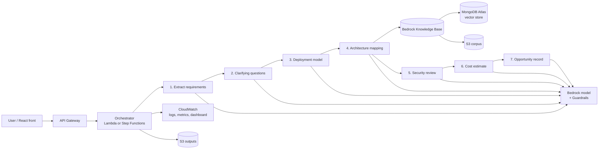

# Discovery-to-Architecture Copilot

> Turns a customer discovery call transcript into requirements, clarifying questions, a cited and costed architecture, a security review and a CRM-ready opportunity record. Built on AWS.

**Status:** in progress (MVP)

---

## Why

Anyone who has done presales knows the evening after a discovery call: rereading notes, chasing missing information, drafting a first architecture from scratch. Requirements get lost, clarifying questions come up too late, and cost and security only get looked at once the design is already sold.

This project automates the first draft of that work, while keeping every choice traceable and reviewable by a human.

**Data:** public documentation and synthetic transcripts only. All companies in the test scenarios are fictional.

---

## PR/FAQ (working backwards)

### Press release

**Discovery-to-Architecture Copilot cuts the time from first customer call to first architecture draft from days to minutes**

Presales engineers spend hours after every discovery call rereading notes, chasing missing information and drafting a first architecture. Discovery-to-Architecture Copilot takes the transcript of a discovery call and returns, in under a minute: the customer's requirements in a structured form, the questions still to ask, a recommended deployment model, a first architecture hypothesis with sources for every choice, a security review, a monthly cost estimate and an opportunity record ready to paste into a CRM.

Every output is traceable. Each architecture choice links to the requirement that motivated it and to the source that supports it. When the transcript doesn't contain enough information, the copilot says so and asks, instead of guessing.

### FAQ

**Who is it for?** Presales engineers, solutions architects and cloud consultants preparing a first proposal after a discovery call.

**Does it replace the architect?** No. It produces a draft. The architect validates, corrects and owns the final design.

**What if the transcript is incomplete?** Missing requirements become clarifying questions, and low-confidence parts are flagged instead of invented.

**Can it recommend not using the public cloud?** Yes. The deployment step can recommend hybrid or on-premises when sovereignty, latency or steady-state cost justify it.

**What does one run cost?** Measured per run and per step (tokens, Lambda, retrieval) and published below. Target: under 0.10 USD per run.

**How do you know it works?** An evaluation set of 15 to 20 synthetic transcripts with expected answers, scored automatically and spot-checked by hand.

**What stops it from hallucinating a service or a spec?** Retrieval with citations, Bedrock Guardrails, and an explicit "not enough information" path.

---

## What it produces

**Input:** a discovery call transcript (plain text, 1 to 4 pages).

| # | Output | Description |
|---|---|---|
| 1 | Requirements | Functional and non-functional (users, scale, latency, availability, data, compliance, budget, timeline), each with a quote from the transcript |
| 2 | Clarifying questions | What's missing or ambiguous, ranked by impact on the design. The main input for the next customer meeting |
| 3 | Deployment model | Public cloud, hybrid or on-prem, with justification |
| 4 | Architecture hypothesis (v0) | A first design to validate in the next meeting: AWS services per component, mapped to requirements, with citations, plus a Mermaid diagram. If key information is missing, it proposes options instead of a single design |
| 5 | Security review | Risks in the proposed design (exposure, IAM, encryption, data residency) and fixes |
| 6 | Cost estimate | Monthly estimate per component, with assumptions stated |
| 7 | Opportunity record | CRM-style JSON: customer need, stakeholders, requirements, next steps |

Every output carries a confidence level (high / medium / low) and the reason for it.

---

## Architecture



| Service | Role | Why this one |
|---|---|---|
| Amazon S3 | Corpus documents, transcripts, run outputs | Cheap, durable, native source for Knowledge Bases |
| Amazon Bedrock | Generation for each step | Managed models, no infra, pay per token |
| Bedrock Knowledge Bases | Ingestion, chunking, embeddings, retrieval with citations | Managed RAG, citations out of the box |
| MongoDB Atlas | Vector store behind the Knowledge Base | Supported by Bedrock KB, free tier avoids a fixed minimum cost |
| AWS Secrets Manager | Vector store credentials | No secrets in code |
| Bedrock Guardrails | Block off-topic, ungrounded or injected content | "I don't know" instead of invented specs |
| AWS Lambda | Step logic | Serverless, pay per use |
| AWS Step Functions (option) | Orchestration of the 7 steps | Visual workflow, retries per step |
| Amazon API Gateway | HTTP API for the front | Managed, throttling |
| Amazon CloudWatch | Logs, custom metrics (tokens, latency, cost), dashboard | Built in |
| AWS Budgets | Cost alarm | Keeps spend under control |

Architecture decisions are documented as ADRs in [`docs/decisions/`](docs/decisions/).

---

## Pipeline

Each step = one prompt + one JSON output schema + one Lambda function. Steps pass a single growing JSON object (`run_state`) to each other. `run_state` carries a `version` (v0 for the first meeting), and requirements and questions keep stable IDs across meetings ([ADR 0001](docs/decisions/0001-stable-ids-and-run-state-versioning.md)).

| Step | Input | Output (JSON) |
|---|---|---|
| 1. Extract requirements | Transcript | `requirements[]` with `id` (R1, R2...), `type`, `category`, `statement`, `evidence_quote`, `confidence` |
| 2. Clarifying questions | Transcript + requirements | `questions[]` with `id` (Q1, Q2...), `question`, `missing_info`, `why_it_matters`, `priority`, `blocking`, `requirement_ids[]`, `status` (open / answered), `confidence` |
| 3. Deployment model | Requirements | `deployment` with `model`, `drivers[]` |
| 4. Architecture mapping | Requirements + deployment + retrieval | `components[]` with `service`, `purpose`, `requirement_ids[]`, `citations[]` + diagram |
| 5. Security review | Architecture | `findings[]` with `risk`, `severity`, `fix` |
| 6. Cost estimate | Architecture + scale assumptions | `costs[]`, `monthly_total`, `assumptions[]` |
| 7. Opportunity record | Everything above | `opportunity` (CRM-style schema) |

Prompts are versioned in [`prompts/`](prompts/) so every change can be evaluated.

---

## Evaluation

| Metric | What it measures |
|---|---|
| Requirement recall / precision | Right requirements found, none invented |
| Question coverage | Planted missing info actually asked about |
| Citation validity | Each cited source supports the choice |
| Faithfulness | Output grounded in transcript and sources |
| Security detection | Planted weaknesses caught |
| Cost accuracy | Gap vs AWS Pricing Calculator |
| Latency, cost per run | Operational metrics |

Test scenarios cover classic cloud workloads, hybrid and sovereignty constraints, enterprise migrations, security-heavy contexts, data and AI platforms, messy or contradictory customers, and prompt injection attempts.

**Results:** coming soon.

---

## Securing the copilot itself

- Least-privilege IAM role per Lambda
- Secrets in Secrets Manager, never in code
- Prompt injection transcripts in the eval set
- Run outputs deleted automatically after N days (S3 lifecycle rule)

---

## Repo structure

```
discovery-copilot/
├── README.md
├── docs/
│   ├── architecture.md
│   └── decisions/          # ADRs
├── prompts/                # one file per step, versioned
├── schemas/                # JSON schema per step output
├── backend/functions/      # one folder per Lambda
├── corpus/                 # list of public sources
├── transcripts/
│   ├── scenarios/
│   └── gold/
├── eval/                   # eval script + results
├── frontend/               # React / Vite
└── .env.example
```

---

## Roadmap

- [ ] Steps 1 and 2: requirements and clarifying questions
- [ ] Steps 3 and 4: deployment model and cited architecture
- [ ] Steps 5 to 7: security review, cost, opportunity record
- [ ] Evaluation harness and observability dashboard
- [ ] Guardrails, API and front end
- [ ] Multi-meeting updates: each new transcript updates the state and versions the architecture (v0 → v1) with a changelog
